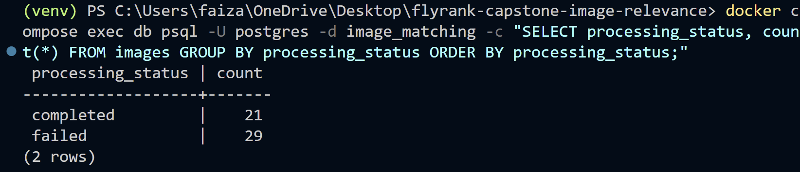
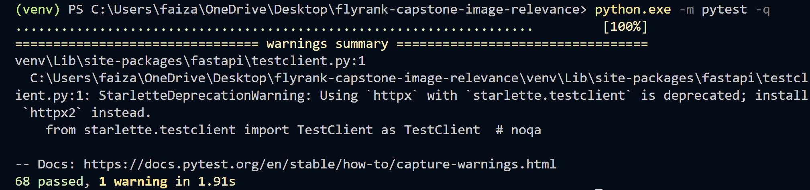
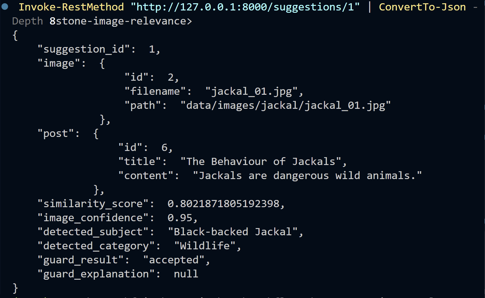
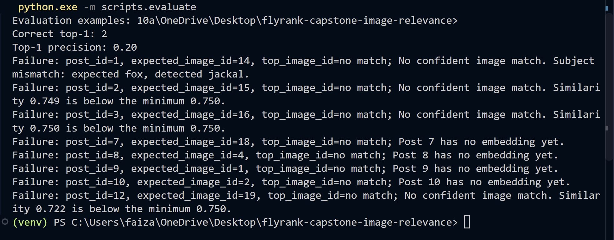

# FlyRank Capstone Evidence

**Verification date:** 2026-10-19
**Scope:** Local application, PostgreSQL, stored records, and automated tests. No Gemini request was made and no image job or embedding generation was triggered during this verification.

## Runtime and database

The repository virtual environment reported Python 3.12.10. Docker Compose reported the PostgreSQL 16 service as running and healthy. Alembic reported revision `0004_persist_match_suggestions (head)`.

```powershell
.\venv\Scripts\python.exe --version
docker compose ps
python -m alembic current
```

The local API health route returned:

```powershell
Invoke-RestMethod -Uri 'http://127.0.0.1:8000/health' -TimeoutSec 5 |
    ConvertTo-Json -Compress
```

```json
{"status":"ok"}
```

This confirms that the health route answered; it is not a database health check.


## Current image-processing status

Read-only PostgreSQL query and result captured on 2026-10-19:

```sql
SELECT count(*) AS total_images,
       count(*) FILTER (WHERE processing_status = 'completed') AS completed,
       count(*) FILTER (WHERE processing_status = 'failed') AS failed,
       count(*) FILTER (WHERE processing_status = 'pending') AS pending,
       count(*) FILTER (WHERE processing_status = 'processing') AS processing
FROM images;
```

```text
 total_images | completed | failed | pending | processing
--------------+-----------+--------+---------+------------
           50 |        21 |     29 |       0 |          0
(1 row)
```

These are database image-record counts, not filesystem counts. There are 29 failed records; no claim is made that all image processing succeeded.

At the same time, the cost log contained 120 `vision` entries and 9 `embedding` entries. These count recorded calls, not successful provider responses. The application records `estimated_cost` as zero; it does not calculate actual Gemini charges.



## Gemini quota limitation

**Operator-reported, not independently reproduced:** Gemini returned HTTP 429 for quota/rate limiting during image processing. No Gemini call was made for this evidence update. The database status counts do not contain the provider response body or map every failed image to a specific error; therefore the exact 429 message, affected IDs, and whether all 29 failures have the same cause have not been verified here. Current quota availability is unknown.

The automated tests use mocked Gemini behavior and do not establish live provider access, quota, or billing.

## Successful image-matching demonstration

This is a previously observed local API response using stored embeddings. It did not call Gemini or regenerate embeddings, and the endpoint was not called again during this cleanup:

```powershell
Invoke-RestMethod -Uri 'http://127.0.0.1:8000/posts/6/images?limit=5' -TimeoutSec 20 |
    ConvertTo-Json -Depth 8
```

Post `6` is **The Behaviour of Jackals**. The observed API response was:

```json
{
  "status": "matched",
  "suggestions": [
    {
      "suggestion_id": 1,
      "image_id": 2,
      "filename": "jackal_01.jpg",
      "path": "data/images/jackal/jackal_01.jpg",
      "similarity_score": 0.8021871805192398,
      "accepted": true,
      "reason": null
    }
  ],
  "reason": "Rejected 1 candidate(s): Subject mismatch: expected jackal, detected hyena."
}
```

The database showed suggestion `1` for image `2` (`jackal_01.jpg`) as accepted with similarity `0.8021871805192398`. The hyena candidate was rejected for subject mismatch. This is a verified response from the local API and existing records at capture time, not a new Gemini result. Calling this matching endpoint persists or updates suggestion records.

The matching screenshot below is a **separate earlier test**, not the post 6 jackal response: it shows a request for post 5 returning `hyena_01.jpg` and rejecting the jackal candidate for subject mismatch.


## Automated tests

Command run with the repository's virtual-environment interpreter:

```powershell
.\venv\Scripts\python.exe -m pytest -q
```

Latest run in this cleanup:

```text
68 passed, 1 warning in 3.57s
```

The warning was a Starlette deprecation warning about using `httpx` with `starlette.testclient`. The suite mocks Gemini and uses fake or in-memory sessions for database-dependent workflows; passing tests do not demonstrate live Gemini behavior or full PostgreSQL integration.

An initial run with the ambient `python` command had 66 passing tests and two failures in `tests/test_vision.py`. Both failed because that interpreter's Google GenAI `Schema` object lacked the `additional_properties` attribute. Running with `.\venv\Scripts\python.exe` passed all 68 tests. Use the repository venv to reproduce the passing result.

The screenshot below is an earlier captured run with the same pass and warning counts; the latest run above completed in 3.57 seconds.



## Suggestion Persistence

The image-matching endpoint successfully generated and stored a suggestion in PostgreSQL.

For post 6 (The Behaviour of Jackals), suggestion 1 was created for image 2 (jackal_01.jpg) with a similarity score of 0.8022 and guard status accepted.

The matching engine also rejected hyena_01.jpg because its subject did not match the article.

The backend provides endpoints to retrieve, approve, and reject suggestions, supporting a human-review workflow. Live approval and rejection were not verified during this evidence capture.

The screenshot shows `GET /suggestions/1` inspection for the persisted post 6 / jackal image 2 match. It supports the stored suggestion details; it is **not** a screenshot of the `/posts/6/images` response itself.



## Evaluation

The captured evaluation output is from an earlier run against the 10 pairs in `data/eval.json`; it was not rerun during this cleanup. A read-only database join verified that each listed post and image ID exists and that each image path maps to a file in the repository. The image files and stored article titles/content were reviewed for subject-level relevance; this does not establish the source/licensing provenance of the images.

**Observed results:**
- Evaluation examples: 10
- Correct top-1 matches: 2
- Top-1 precision: 0.20 (20%)

The captured run's eight unsuccessful examples included four posts without embeddings, three below-threshold matches, and one subject mismatch.

Most labels align with the article's broad animal subject. Two content-specific pairings remain ambiguous: post 5, **Wild hyenas in the Forest**, describes a threat/defensive display, while `hyena_01.jpg` shows a hyena walking and does not visibly show that behavior; post 12, **Red Foxes in Winter**, is paired with `fox_07.jpg`, which shows a fox in a green setting rather than a winter scene. These labels were not changed. The 20% result is the observed score for the supplied labels and should be treated cautiously until a human confirms those pairings.

| Post ID | Post title | Image ID | File | Validation |
|---:|---|---:|---|---|
| 1 | Red foxes in winter | 14 | `fox_01.jpg` | Fox in snowy scene; broad and seasonal match |
| 2 | The Behavior of Red Foxes | 15 | `fox_02.jpg` | Fox subject confirmed |
| 3 | Red Fox Habitat and Behavior | 16 | `fox_03.jpg` | Fox subject confirmed |
| 5 | Wild hyenas in the Forest | 1 | `hyena_01.jpg` | Hyena subject confirmed; described behavior not visibly shown (ambiguous) |
| 6 | The Behaviour of Jackals | 2 | `jackal_01.jpg` | Jackal subject confirmed |
| 7 | Red foxes in the wild | 18 | `fox_06.jpg` | Fox subject confirmed |
| 8 | Understanding domestic dogs | 4 | `dog_01.jpg` | Dog subject confirmed |
| 9 | Hyenas and their habitats | 1 | `hyena_01.jpg` | Hyena subject confirmed |
| 10 | Jackals of the wild | 2 | `jackal_01.jpg` | Jackal subject confirmed |
| 12 | Red Foxes in Winter | 19 | `fox_07.jpg` | Fox subject confirmed; winter context not visible (ambiguous) |



**Command used for the captured earlier run:**

`.\venv\Scripts\python.exe -m scripts.evaluate`

The evaluation command was not rerun during this cleanup because its matcher path persists suggestion records. No suggestion records or evaluation labels were modified as part of this cleanup.