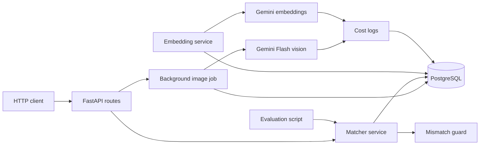

# FlyRank.AI Capstone: AI Image Understanding & Content Matching Engine

A backend capstone that analyzes a local image library, stores validated metadata and semantic embeddings in PostgreSQL, ranks images for blog posts, and rejects candidates that fail configurable mismatch checks.

## Requirements

- Python 3.11 or newer
- Docker Desktop with Docker Compose
- A Gemini API key for image analysis and embedding generation

The test suite uses mocked AI responses and does not require a Gemini key.

## Architecture



HTTP routes validate input and call services. Services contain vision, embedding, matching, guard, and review logic. SQLAlchemy models and Alembic migrations own persistence. AI calls do not write to the database directly; jobs/services persist results through the SQLAlchemy session.

## Setup

Run commands from the repository root.

### Windows PowerShell

```powershell
py -3 -m venv .venv
.\.venv\Scripts\Activate.ps1
python --version
python -m pip install --upgrade pip
python -m pip install -r requirements.txt
if (-not (Test-Path .env)) { Copy-Item .env.example .env }
```

Run these commands from the repository root. Create `.venv` once per checkout; activate it in every new PowerShell session. Confirm `python --version` is 3.11 or newer and that `python` resolves to `.venv\Scripts\python.exe`. The conditional copy preserves an existing local `.env`. Add a valid `GEMINI_API_KEY` locally before invoking Gemini-backed features. Never commit `.env` or share its contents.

### macOS/Linux

```bash
python3 -m venv .venv
source .venv/bin/activate
python --version
python -m pip install --upgrade pip
python -m pip install -r requirements.txt
cp .env.example .env
```

## Database and seed data

Start Docker Desktop, then start PostgreSQL and apply all migrations:

```powershell
docker compose up -d db
python -m alembic upgrade head
```

Seed the database with the repository's images and five sample animal posts:

```powershell
python -m scripts.seed
```

The seed is safe to rerun: it does not duplicate images with the same path or posts with the same seeded title. Image rows start with `processing_status=pending`.

## Run the API

```powershell
python -m uvicorn app.main:app --reload
```

The API listens at `http://127.0.0.1:8000`. Interactive OpenAPI documentation is at `http://127.0.0.1:8000/docs`.

Confirm the server responds before trying database-backed routes:

```powershell
curl.exe http://127.0.0.1:8000/health
```

## Process images

With the API running and `GEMINI_API_KEY` configured, submit the pending image rows to the background worker:

```powershell
curl.exe -X POST http://127.0.0.1:8000/jobs/process-images
```

The response includes the job ID. Check progress with that ID:

```powershell
curl.exe http://127.0.0.1:8000/jobs/1
```

Processing calls Gemini Flash, validates its response against the Pydantic image metadata schema, saves valid metadata, and marks low-confidence results for review. Invalid output is not saved. Failed images are marked `failed`; to retry them, reset their status explicitly in PostgreSQL:

```powershell
docker compose exec db psql -U postgres -d image_matching -c "UPDATE images SET processing_status = 'pending' WHERE processing_status = 'failed' RETURNING id, filename;"
```

## Generate embeddings

Image-caption embeddings and embeddings for existing posts are generated by this explicit CLI step after image metadata processing. With a valid Gemini key, run:

```powershell
python -m scripts.seed --embeddings
```

This idempotently ensures the seed data exists, then generates missing vectors for image captions and post title-plus-content. A SHA-256 source hash prevents regenerating a vector when its source text has not changed. Each Gemini call creates a `CostLog` row before the request. `estimated_cost` is currently `0`; token-based pricing is not configured.

## Create an article

`POST /posts` creates an article and automatically generates and stores its embedding. Both `title` and `content` are required nonblank strings; title is limited to 500 characters. A valid Gemini key is required. Example from PowerShell:

```powershell
$body = @{
    title   = "Red Foxes in Winter"
    content = "This article describes how red foxes find food and shelter during winter."
} | ConvertTo-Json

$post = Invoke-RestMethod -Method Post `
    -Uri "http://127.0.0.1:8000/posts" `
    -ContentType "application/json" `
    -Body $body

$post | Format-List
$postId = $post.id
```

The response includes `id`, `title`, `content`, and `created_at`. Invalid input returns 422; missing embedding configuration returns 503. If embedding generation fails after the post is saved, the API returns 502; check the database for that post before retrying.

## Rank images and guard mismatches

Request the top accepted images for a post:

```powershell
curl.exe "http://127.0.0.1:8000/posts/1/images?limit=5"
```

The matcher uses cosine similarity over stored embeddings. The mismatch guard additionally checks minimum similarity, image confidence, subject, and category. Defaults are `MIN_SIMILARITY=0.75` and `MIN_CONFIDENCE=0.70`; configure them in `.env` to override them. Similarity is a cosine score, not a probability.

Only candidates that pass the similarity, confidence, supported-subject, and category checks are returned in `suggestions`. A successful response has `status: "matched"` and a ranked suggestions array; each accepted candidate contains a `suggestion_id` for review. If none pass, the endpoint returns HTTP 200 with `status: "no_confident_match"` and a reason. The matcher persists rejected candidates too, but they are not returned as accepted recommendations.

```powershell
$match = Invoke-RestMethod -Uri "http://127.0.0.1:8000/posts/1/images?limit=5"
$match.suggestions | Format-Table suggestion_id, image_id, filename, similarity_score
```

Repeated matching updates the same post/image suggestion row rather than creating a duplicate, preserving its suggestion ID and related review history.

If no image passes the guard, the endpoint returns HTTP 200 with:

```json
{
	"status": "no_confident_match",
	"suggestions": [],
	"reason": "No confident image match. Subject mismatch: expected fox, detected wolf."
}
```

## Human review workflow

Matching returns a `suggestion_id` for each accepted candidate. Inspect it before making a human decision:

```powershell
$suggestionId = $match.suggestions[0].suggestion_id
Invoke-RestMethod -Uri "http://127.0.0.1:8000/suggestions/$suggestionId" |
    ConvertTo-Json -Depth 8
```

Inspection includes the related post and image, similarity, confidence, detected subject/category, and guard result/explanation. Choose one action for the suggestion. Each action creates a review row; the API accepts an optional JSON body, but no body is required:

```powershell
# Approve:
Invoke-RestMethod -Method Post `
    -Uri "http://127.0.0.1:8000/suggestions/$suggestionId/approve"

# Or reject:
Invoke-RestMethod -Method Post `
    -Uri "http://127.0.0.1:8000/suggestions/$suggestionId/reject"
```

A request body is optional; if supplied, its `decision` must agree with the action path (`approve` or `reject`). Invalid/mismatched bodies return 422 and unknown suggestion IDs return 404. To investigate a no-match response, rejected candidates can be found in the database:

```powershell
docker compose exec db psql -U postgres -d image_matching -c "SELECT id, image_id, guard_status, guard_reason FROM suggestions WHERE post_id = 1 ORDER BY similarity_score DESC;"
```

## Evaluation Results

The evaluation was executed on 2026-10-19 using 10 labeled post-image examples.

| Metric | Result |
|---|---|
| Evaluation examples | 10 |
| Correct top-1 matches | 2 |
| Top-1 precision | 0.20 (20%) |

The evaluation identified eight unsuccessful matches. Four posts had no stored embeddings, three were rejected because their similarity scores were below the configured threshold, and one was rejected due to a subject mismatch.

The results reflect the current state of the local database and incomplete embedding coverage. They should not be interpreted as the system's maximum achievable accuracy.

Evaluation command:

`.\venv\Scripts\python.exe -m scripts.evaluate`

The ten labels refer to existing database image IDs and repository files. A manual comparison confirms the animal subject for most pairs; the hyena action described by post 5 is not visibly shown, and the fox image for post 12 does not depict a winter setting. The reported score is the evaluator's result for the current labels, not a claim that all labels are confirmed ground truth.

## Cost and data inspection

Vision and embedding calls are logged in `cost_logs`, including retries. Inspect generated image metadata with:

```powershell
docker compose exec db psql -U postgres -d image_matching -c "SELECT i.id, i.filename, i.processing_status, m.subject, m.category, m.caption, m.confidence, m.needs_review FROM images i LEFT JOIN image_metadata m ON m.image_id = i.id ORDER BY i.id;"
```

Inspect recorded AI operations:

```powershell
docker compose exec db psql -U postgres -d image_matching -c "SELECT operation, model_name, image_id, post_id, estimated_cost, created_at FROM cost_logs ORDER BY id;"
```

## Important endpoints

| Method | Path | Purpose |
| --- | --- | --- |
| GET | `/health` | API health check |
| POST | `/jobs/process-images` | Queue pending images |
| GET | `/jobs/{job_id}` | Read job status and progress |
| POST | `/posts` | Create an article and generate its embedding |
| GET | `/posts/{post_id}/images` | Return guarded ranked candidates |
| GET | `/suggestions/{suggestion_id}` | Inspect a persisted suggestion |
| POST | `/suggestions/{suggestion_id}/approve` | Persist an approval |
| POST | `/suggestions/{suggestion_id}/reject` | Persist a rejection |

## Tests

Run the full mocked test suite:

```powershell
python -m pytest -q
```

Tests cover schema validation, background job retries/idempotency/cost logging, embedding idempotency, deterministic cosine ranking, mismatch rejection, review API behavior, and evaluation calculations. They do not make Gemini calls.

## Current Verification Status (2026-10-19)

The backend has been tested locally using FastAPI, PostgreSQL, and the repository's Python virtual environment.

**Verified results:**
- 50 images registered across five categories: dog, fox, hyena, jackal, and wolf.
- 21 images successfully processed; 29 image records failed processing.
- 2 image-caption embeddings and 7 article embeddings stored.
- Successful semantic match for post `6`, **The Behaviour of Jackals**.
- The matching engine selected `jackal_01.jpg` with cosine similarity `0.8022`.
- The mismatch guard rejected `hyena_01.jpg` because its subject did not match the article.
- Matching suggestions are persisted in PostgreSQL and can be inspected through the API.
- Automated tests: **68 passed, 1 warning**, using mocked Gemini integrations.

**Reproduce the successful match:**

```powershell
Invoke-RestMethod "http://127.0.0.1:8000/posts/6/images?limit=5" |
    ConvertTo-Json -Depth 8
```

This request uses existing stored embeddings and does not require a new Gemini API call.

**Known limitations:**
- The operator reported Gemini HTTP 429 quota/rate limiting during image processing; this was not independently reproduced, and current quota availability is unknown.
- The remaining failed images have not been successfully reprocessed.
- AI calls are logged, but actual provider costs are not calculated and an automated budget guard is not implemented.

See `EVIDENCE.md` for captured API responses, database results, and test evidence.

## Limitations

- There is no image-upload endpoint. Add supported image files under `data/images/` and run the seed script to register their paths. Image files remain on disk; PostgreSQL stores paths and metadata.
- Image processing and embedding generation require Gemini access and can be affected by provider quota/rate limits. Image-caption and seeded-post embeddings are generated by the CLI; `POST /posts` generates a post embedding automatically.
- The mismatch guard supports only the subjects and compatible categories configured in `app/services/mismatch_guard.py`; unsupported or unrecognized subjects/categories fail closed.
- Cost-log entries are recorded, but `estimated_cost` is always zero; actual provider charges are not calculated.
- Embeddings are stored as PostgreSQL JSONB for this capstone; no vector extension or separate vector database is used.